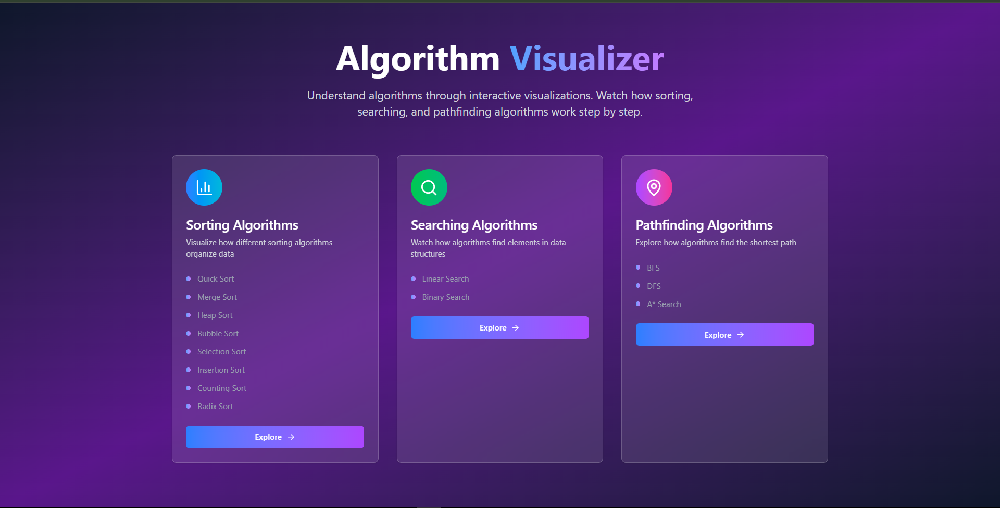

# 🧠 Algorithm Visualizer

An interactive web application to **visually demonstrate classic algorithms** like sorting, searching, and pathfinding through real-time animations. Built using **Next.js**, **Framer Motion**, and **Tailwind CSS**, this tool helps learners understand how algorithms work internally via intuitive visuals.

---

## 🚀 Live Demo

👉 [View Live Project](https://algorithm-visualizer-apdev.netlify.app/)  

---

## 📸 Preview

  

---

## 🛠 Tech Stack

- **Next.js (JavaScript)** – App framework  
- **Tailwind CSS** – Styling  
- **Framer Motion** – Animations  
- **Lucide React** – Icons  
- **React Context API** – State management  
- **Node.js + Express** *(Optional)* – Backend server  
- **MongoDB** *(Optional)* – For storing custom runs or analytics  

---

## 📊 Supported Algorithms

### 🔁 Sorting
- Quick Sort  
- Merge Sort  
- Heap Sort  
- Selection sort 
- Bubble sort 
- Insertion sort 
- Counting sort 
- Radix sort

### 🔎 Searching
- Linear Search  
- Binary Search  

### 🌐 Pathfinding
- Breadth-First Search (BFS)  
- Depth-First Search (DFS)  
- A* Search  

---

## ✨ Features

- 🎥 Real-time algorithm visualization  
- 🕹️ Interactive controls (speed, size, reset, pause)  
- 📊 Step-by-step comparisons, swaps, and traversal  
- 📱 Fully responsive UI  
- ℹ️ Info modals with algorithm details (complexity, logic, pseudocode)  

---

## 💻 Getting Started

### 1. Clone & Install

```
git clone https://github.com/your-username/algorithm-visualizer.git
cd algorithm-visualizer
npm install
npm run dev
```
## 🧠 Future Scope
- Add advanced algorithms (e.g., Dijkstra's, Bellman-Ford)
- User authentication & saved sessions
- Leaderboard for optimal solutions
- Export visualizations as GIFs or videos
- Toggle between light/dark themes

## 📄 License
This project is licensed under the MIT License.

## 🙌 Credits
- Built with 💻 by Aditya Pippal
- Icons by Lucide.dev
- Animations powered by Framer Motion
